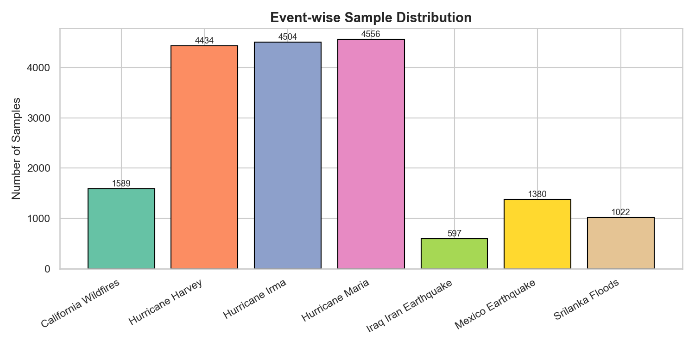
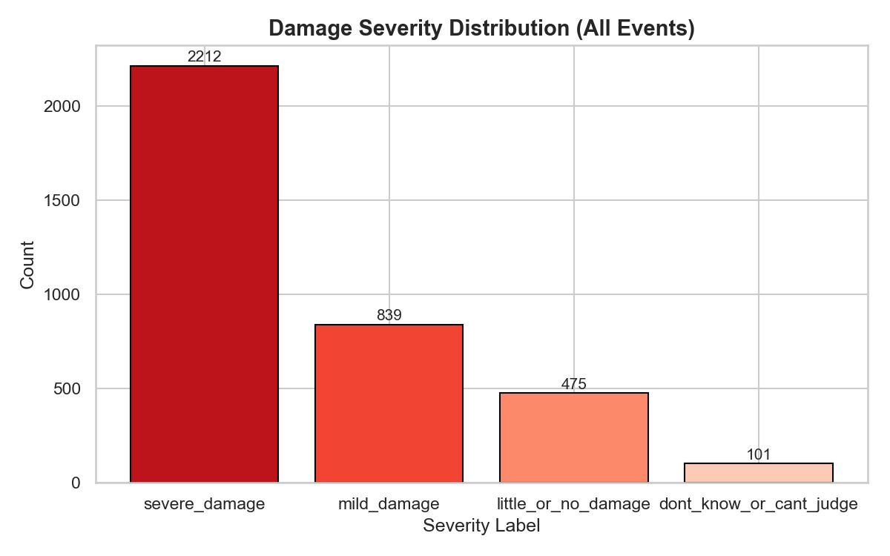
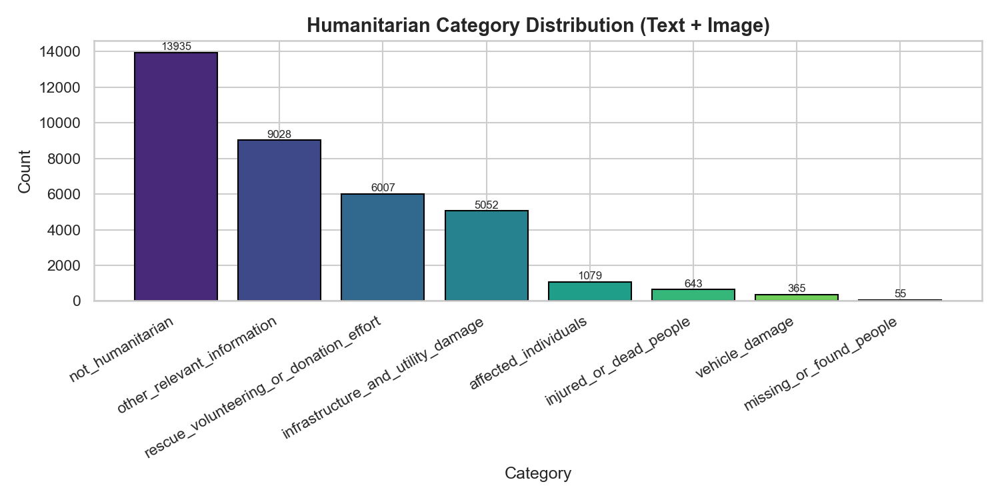

# 01 — Dataset Analysis

## 1. Dataset Description

CrisisMMD v2.0 is a multimodal Twitter dataset consisting of thousands of manually annotated tweets and images collected during seven major natural disasters that occurred in 2017. The dataset was created by Firoj Alam, Ferda Ofli, and Muhammad Imran at the Qatar Computing Research Institute.

**Reference:**
> Firoj Alam, Ferda Ofli, and Muhammad Imran. "CrisisMMD: Multimodal Twitter Datasets from Natural Disasters." *AAAI Conference on Web and Social Media (ICWSM)*, 2018.

## 2. Dataset Statistics

| Metric | Value |
|---|---|
| **CrisisMMD Version** | v2.0 |
| **Number of Disaster Events** | 7 |
| **Total TSV Files** | 7 |
| **Total Columns** | 15 |
| **Total Rows (Tweet-Image Pairs)** | 18,082 |
| **Unique Tweets** | 16,058 |
| **Unique Images** | 18,082 |
| **Severity-Annotated Samples** | 3,627 |
| **After Removing `dont_know_or_cant_judge`** | 3,526 |
| **Missing Image Paths** | 0 |

## 3. Disaster Events

| Event | Type | Location | Year | Samples |
|---|---|---|---|---|
| California Wildfires | Wildfire | USA | 2017 | 1,589 |
| Hurricane Harvey | Hurricane | USA | 2017 | 4,434 |
| Hurricane Irma | Hurricane | USA/Caribbean | 2017 | 4,504 |
| Hurricane Maria | Hurricane | Caribbean | 2017 | 4,556 |
| Iraq-Iran Earthquake | Earthquake | Iraq/Iran | 2017 | 597 |
| Mexico Earthquake | Earthquake | Mexico | 2017 | 1,380 |
| Sri Lanka Floods | Flood | Sri Lanka | 2017 | 1,022 |



## 4. Annotation Columns

| Column | Description |
|---|---|
| `tweet_id` | Original tweet ID from Twitter |
| `image_id` | Unique image identifier (tweet_id + index) |
| `text_info` | Informativeness label for tweet text |
| `image_info` | Informativeness label for tweet image |
| `text_human` | Humanitarian category for text |
| `image_human` | Humanitarian category for image |
| `image_damage` | Damage severity label (target) |
| `tweet_text` | Raw tweet text |
| `image_path` | Relative path to image file |

## 5. Severity Distribution (Target Variable)

| Label | Count | Percentage |
|---|---|---|
| **severe_damage** | 2,212 | 62.74% |
| **mild_damage** | 839 | 23.79% |
| **little_or_no_damage** | 475 | 13.47% |



### Key Observation: Class Imbalance

The severity labels exhibit significant class imbalance:
- **severe_damage** is the majority class (62.74%)
- **little_or_no_damage** is severely underrepresented (13.47%)
- The imbalance ratio between majority and minority is approximately **4.7:1**

This imbalance is addressed during training using **class-weighted CrossEntropyLoss**.

## 6. Humanitarian Category Distribution

| Category | Text Count | Image Count |
|---|---|---|
| Not Humanitarian | 5,227 | 8,708 |
| Other Relevant Information | 6,499 | 2,529 |
| Rescue/Volunteering/Donation | 3,776 | 2,231 |
| Infrastructure/Utility Damage | 1,428 | 3,624 |
| Injured or Dead People | 533 | 110 |
| Affected Individuals | 517 | 562 |
| Vehicle Damage | 61 | 304 |
| Missing or Found People | 41 | 14 |



## 7. Informativeness Distribution

| Label | Text | Image |
|---|---|---|
| Informative | 12,855 (71.09%) | 9,374 (51.84%) |
| Not Informative | 5,227 (28.91%) | 8,708 (48.16%) |

## 8. Missing Value Analysis

Missing values are present only in the `image_damage` and `image_damage_conf` columns across all events. This is by design — severity assessment is only performed for images labeled as "infrastructure and utility damage" under the humanitarian task. All other columns (tweet_id, image_id, text, image path) have zero missing values.

## 9. Dataset Directory Structure

```
CrisisMMD_v2.0/
├── annotations/
│   ├── california_wildfires_final_data.tsv
│   ├── hurricane_harvey_final_data.tsv
│   ├── hurricane_irma_final_data.tsv
│   ├── hurricane_maria_final_data.tsv
│   ├── iraq_iran_earthquake_final_data.tsv
│   ├── mexico_earthquake_final_data.tsv
│   └── srilanka_floods_final_data.tsv
├── data_image/
│   ├── california_wildfires/
│   ├── hurricane_harvey/
│   ├── hurricane_irma/
│   ├── hurricane_maria/
│   ├── iraq_iran_earthquake/
│   ├── mexico_earthquake/
│   └── srilanka_floods/
├── json/
└── Readme.txt
```

## 10. Dataset Suitability for CrisisMind

**Strengths:**
- Real-world disaster data from multiple event types (hurricane, earthquake, wildfire, flood)
- Expert-annotated with multiple tasks (informativeness, humanitarian, severity)
- Multimodal: each sample includes both image and text
- Severity labels are directly usable for the damage assessment task
- Reasonable dataset size for transfer learning approaches

**Limitations:**
- Class imbalance (severe_damage dominates)
- Moderate dataset size for deep learning (3,526 severity samples)
- Geographic and temporal bias (only 2017 events)
- Severity labels only available for infrastructure-damage images
