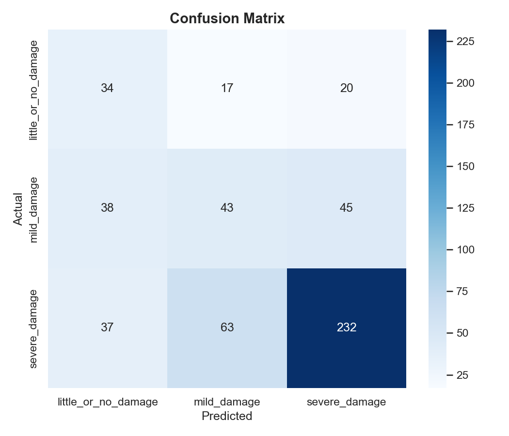
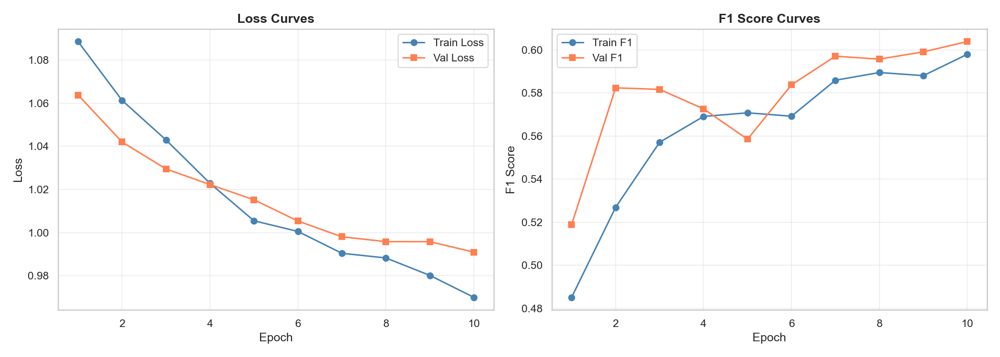

# 02 — Image Baseline Model

## 1. Objective

Establish a unimodal baseline for damage severity classification using **only disaster images**. This model serves as the image-only benchmark against which the multimodal fusion models are compared.

## 2. Model Architecture

### EfficientNet-B0

**Architecture:** EfficientNet-B0 pretrained on ImageNet-1K

| Component | Detail |
|---|---|
| Base Model | EfficientNet-B0 |
| Pretrained Weights | ImageNet-1K (via torchvision) |
| Input Size | 224 × 224 × 3 |
| Backbone | MBConv blocks with Squeeze-and-Excitation |
| Feature Dimension | 1,280 |
| Classifier Head | Dropout(0.2) → Linear(1280, 3) |
| Total Parameters | 4,011,391 |
| Trainable Parameters | 3,843 (classifier only) |

### Transfer Learning Strategy

- **Backbone frozen** during training — ImageNet-pretrained weights are kept fixed
- **Only the classifier head** (3,843 params) is trained from scratch
- This approach prevents overfitting given the moderate dataset size (3,526 samples)

## 3. Dataset Preprocessing

- Filter records where `image_damage` is available
- Remove `dont_know_or_cant_judge` label
- Verify image file existence on disk
- Label mapping: little_or_no_damage → 0, mild_damage → 1, severe_damage → 2
- Drop duplicate image-text pairs

### Image Augmentations (Training)

| Transform | Parameter |
|---|---|
| Resize | 224 × 224 |
| Random Horizontal Flip | p = 0.5 |
| Random Rotation | ±15 degrees |
| Normalization | ImageNet mean/std |

### Image Transforms (Validation/Test)

| Transform | Parameter |
|---|---|
| Resize | 224 × 224 |
| Normalization | ImageNet mean/std |

## 4. Data Split

| Split | Samples | Percentage |
|---|---|---|
| Train | 2,468 | 70% |
| Validation | 529 | 15% |
| Test | 529 | 15% |

**Strategy:** Stratified split preserving class proportions across all splits.

## 5. Hyperparameters

| Parameter | Value |
|---|---|
| Optimizer | Adam |
| Learning Rate | 1 × 10⁻⁴ |
| Batch Size | 32 |
| Max Epochs | 50 |
| Patience (Early Stopping) | 7 |
| Loss Function | CrossEntropyLoss (class-weighted) |
| LR Scheduler | ReduceLROnPlateau (mode=max, patience=3, factor=0.5) |
| Class Weight Method | Inverse frequency normalized to sum(num_classes) |

## 6. Test Set Results

### Overall Metrics

| Metric | Value |
|---|---|
| Accuracy | 0.5841 |
| Precision (Weighted) | 0.6154 |
| Recall (Weighted) | 0.5841 |
| F1 Score (Weighted) | 0.5959 |
| Precision (Macro) | 0.4809 |
| Recall (Macro) | 0.5063 |
| **F1 Score (Macro)** | **0.4869** |

### Class-Wise Performance

| Class | Precision | Recall | F1-Score | Support |
|---|---|---|---|---|
| little_or_no_damage | 0.3119 | 0.4789 | 0.3778 | 71 |
| mild_damage | 0.3496 | 0.3413 | 0.3454 | 126 |
| severe_damage | 0.7811 | 0.6988 | 0.7377 | 332 |

## 7. Training Curves

## 8. Observations

1. The model performs best on **severe_damage** (F1 = 0.7377), which is the majority class
2. **little_or_no_damage** has the lowest F1 (0.3778), reflecting the class imbalance
3. The model shows **high precision** for severe_damage (0.7811) but lower recall (0.6988)
4. Training converges within 5 epochs due to the frozen backbone approach
5. Class weighting helps but does not fully resolve the imbalance issue

## 9. Limitations

1. Frozen backbone limits the model's ability to learn disaster-specific visual features
2. Image-only model misses contextual information present in tweet text
3. Class imbalance severely impacts minority class performance
4. Single-image input cannot capture before/after damage comparison
