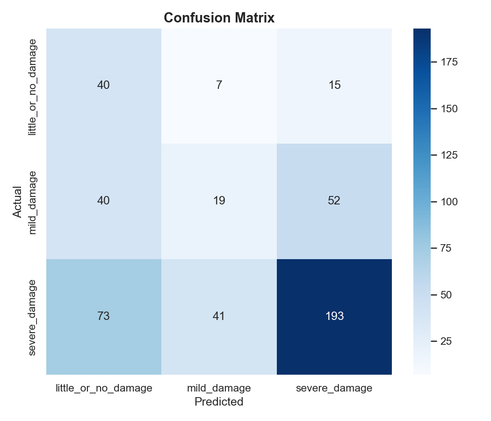

# 03 — Text Baseline Model

## 1. Objective

Establish a unimodal baseline for damage severity classification using **only tweet text**. This model serves as the text-only benchmark against which the multimodal fusion models are compared.

## 2. Model Architecture

### DistilBERT (distilbert-base-uncased)

| Component | Detail |
|---|---|
| Base Model | DistilBERT (distilbert-base-uncased) |
| Pretrained Weights | DistilBERT (Hugging Face) |
| Vocabulary Size | 30,522 |
| Hidden Dimension | 768 |
| Number of Layers | 6 (transformer) |
| Attention Heads | 12 |
| Classifier Head | Pre-classifier(768, 768) → Linear(768, 3) |
| Total Parameters | ~67 million |
| Trainable Parameters | ~67 million (full fine-tuning) |

### Fine-tuning Strategy

- **Full fine-tuning** — all DistilBERT parameters are updated during training
- The pre-trained language model weights serve as initialization
- The classifier head (pre_classifier + classifier) is randomly initialized

## 3. Text Preprocessing

| Step | Operation |
|---|---|
| URL Removal | Strip `http://` and `https://` URLs |
| Whitespace Normalization | Collapse multiple spaces |
| Hashtag Preservation | Hashtags retained for disaster context |
| Lowercasing | DistilBERT is uncased |
| Truncation | Max 64 tokens |
| Padding | Pad to max length with `[PAD]` token |

### Tokenization

- **Tokenizer:** DistilBertTokenizer from Hugging Face
- **Strategy:** WordPiece tokenization
- **Sequence Length:** 64 tokens (truncation + padding)
- **Special Tokens:** `[CLS]` (classification), `[SEP]` (separator), `[PAD]` (padding)

**Preprocessing Example:**
```
Original:    "RT @USER: Severe damage reported near downtown https://t.co/xyz"
Cleaned:     "RT @USER: Severe damage reported near downtown"
Tokenized:   ["[CLS]", "rt", "@", "user", ":", "severe", "damage", 
              "reported", "near", "downtown", "[SEP]", "[PAD]", ...]
```

## 4. Data Split

| Split | Samples | Percentage |
|---|---|---|
| Train | 2,238 | 70% |
| Validation | 480 | 15% |
| Test | 480 | 15% |

**Note:** Text samples differ from image samples because:
- Tweet text deduplication removes 328 duplicate texts
- 3,198 unique text samples vs 3,526 image samples

## 5. Hyperparameters

| Parameter | Value |
|---|---|
| Optimizer | AdamW |
| Learning Rate | 2 × 10⁻⁵ |
| Batch Size | 16 |
| Max Epochs | 30 |
| Patience (Early Stopping) | 5 |
| Loss Function | CrossEntropyLoss (class-weighted) |
| LR Scheduler | LinearLR (start=1.0, end=0.1) |
| Max Sequence Length | 64 tokens |
| Class Weight Method | Inverse frequency normalized to sum(num_classes) |

## 6. Test Set Results

### Overall Metrics

| Metric | Value |
|---|---|
| Accuracy | 0.5250 |
| Precision (Weighted) | 0.5741 |
| Recall (Weighted) | 0.5250 |
| F1 Score (Weighted) | 0.5328 |
| Precision (Macro) | 0.4291 |
| Recall (Macro) | 0.4817 |
| **F1 Score (Macro)** | **0.4221** |

### Class-Wise Performance

| Class | Precision | Recall | F1-Score | Support |
|---|---|---|---|---|
| little_or_no_damage | 0.2614 | 0.6452 | 0.3721 | 62 |
| mild_damage | 0.2836 | 0.1712 | 0.2135 | 111 |
| severe_damage | 0.7423 | 0.6287 | 0.6808 | 307 |



## 7. Training Curves

*Note: Training curves from the initial DistilBERT fine-tuning run were not preserved in the final checkpoint. The curves shown below are from the Concat Fusion training for reference.*

## 8. Observations

1. DistilBERT achieves **lower Macro F1 (0.4221)** compared to the image baseline (0.4869)
2. The model shows **high recall** for little_or_no_damage (0.6452) but **very low precision** (0.2614) — it over-predicts this class
3. **mild_damage** is the most challenging class (F1 = 0.2135), with very low recall (0.1712)
4. Tweet text alone may be ambiguous — a tweet mentioning "severe damage" could accompany any image
5. The text modality captures intent and context but lacks visual evidence of actual damage

## 9. Limitations

1. Tweets are short (average 13 words), limiting available context
2. Text alone cannot capture structural damage severity visually
3. Sarcasm, hyperbole, and reporting of second-hand information reduce reliability
4. Duplicate tweets (retweets, news sharing) reduce effective sample size
5. URL shortening and Twitter-specific formatting complicate preprocessing
