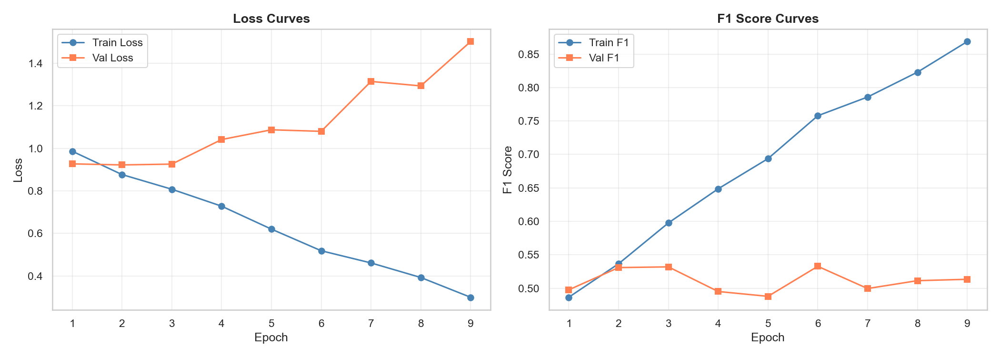
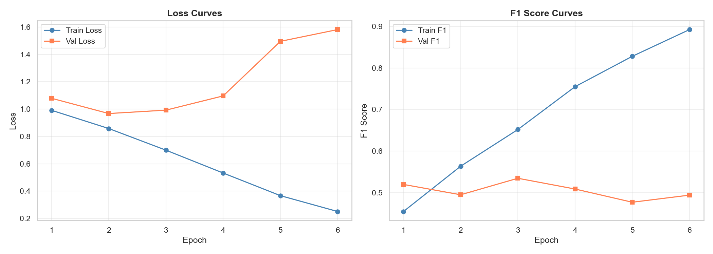

# 04 — Multimodal Fusion Model

## 1. Motivation

Unimodal models (image-only or text-only) have inherent limitations:

- **Images** capture structural damage visually but lack context (location, time, reported casualties)
- **Text** provides context and reported information but cannot convey visual damage severity

A multimodal approach combines complementary information: the image shows **what** damage occurred, while the text provides **where**, **when**, and **how** it was reported. This fusion is expected to produce more robust severity classifications.

## 2. Feature Extraction

### Image Features (EfficientNet-B0)

| Component | Detail |
|---|---|
| Backbone | EfficientNet-B0 (pretrained on ImageNet) |
| Checkpoint | `best_model.pth` (from Phase 1) |
| Extraction Layer | Penultimate layer (before classifier) |
| Feature Dimension | **1,280** |
| Frozen | Yes (weights locked) |

### Text Features (DistilBERT)

| Component | Detail |
|---|---|
| Backbone | DistilBERT (distilbert-base-uncased) |
| Checkpoint | `best_text_model.pth` (from Phase 2) |
| Extraction Layer | CLS token from last hidden state |
| Feature Dimension | **768** |
| Frozen | Yes (weights locked) |

### Feature Extraction Strategy

Features are **pre-extracted once** and cached to disk, enabling fast training of fusion layers without re-running the heavy unimodal encoders. This reduces training time from hours to seconds.

**Cached Feature Storage:**
```
backend/outputs/cached_features/
├── train/features.pt     # 2,468 samples
├── val/features.pt       # 529 samples
└── test/features.pt      # 529 samples
```

## 3. Fusion Model A: Concatenation Fusion

### Architecture

```
Image (224×224) ─→ EfficientNet-B0 ─→ [1280-d embedding]
                                              │
Text (64 tokens) ─→ DistilBERT ─────→ [768-d embedding]
                                              │
                                    Concatenate → [2048-d]
                                              │
                                       Linear(2048, 512)
                                              │
                                          ReLU
                                              │
                                       Dropout(0.3)
                                              │
                                        Linear(512, 3)
                                              │
                                        softmax → prediction
```

| Component | Detail |
|---|---|
| Input Dim | 2,048 (1280 image + 768 text) |
| Hidden Dim | 512 |
| Dropout | 0.3 |
| Output Dim | 3 (severity classes) |
| Trainable Params | 1,050,627 |

### Concatenation Fusion: Test Results

| Metric | Value |
|---|---|
| Accuracy | 0.6371 |
| Precision (Weighted) | 0.6439 |
| Recall (Weighted) | 0.6371 |
| F1 (Weighted) | 0.6400 |
| Precision (Macro) | 0.5332 |
| Recall (Macro) | 0.5287 |
| **F1 (Macro)** | **0.5302** |

### Class-Wise Performance (Concat)

| Class | Precision | Recall | F1-Score | Support |
|---|---|---|---|---|
| little_or_no_damage | 0.4308 | 0.3944 | 0.4118 | 71 |
| mild_damage | 0.3786 | 0.4206 | 0.3985 | 126 |
| severe_damage | 0.7901 | 0.7711 | 0.7805 | 332 |

## 4. Fusion Model B: Gated Fusion

### Architecture

The Gated Fusion network learns **adaptive modality weighting** through a lightweight gating mechanism. This allows the model to dynamically adjust how much information to take from each modality per sample.

```
Image (224×224) ─→ EfficientNet-B0 ─→ [1280-d] ──→ gate_img ★
                                                         │
Text (64 tokens) ─→ DistilBERT ─────→ [768-d] ──→ gate_txt ★
                                                         │
                    ┌── Concat(1280+768) ──→ Gate Network ──→ [gate_img, gate_txt]
                    │
                    └── [gated_img, gated_txt] ──→ Concatenate ──→ Linear(2048,512)
                                                                         │
                                          gate_img = σ(FC(img_feat))     ReLU
                                          gate_txt = σ(FC(txt_feat))       │
                                                                        Dropout(0.3)
                                                                           │
                                                                        Linear(512,3)
                                                                           │
                                                                        softmax
```

### Gating Mechanism

For each sample, the gate network computes:

```
g_img = σ(W_i · [img_feat; txt_feat] + b_i)
g_txt = σ(W_t · [img_feat; txt_feat] + b_t)
fused = [g_img * img_feat; g_txt * txt_feat]
```

Where σ is the sigmoid function, ensuring gates are in (0, 1). The gates are **sample-dependent** — different inputs can weight modalities differently.

| Component | Detail |
|---|---|
| Input Dim | 2,048 (1280 image + 768 text) |
| Gate Network | Linear(2048, 64) → ReLU → Linear(64, 2) → Sigmoid |
| Hidden Dim | 512 |
| Dropout | 0.3 |
| Output Dim | 3 (severity classes) |
| Trainable Params | 1,181,893 |

### Gated Fusion: Test Results

| Metric | Value |
|---|---|
| Accuracy | 0.6352 |
| Precision (Weighted) | 0.6493 |
| Recall (Weighted) | 0.6352 |
| F1 (Weighted) | 0.6415 |
| Precision (Macro) | 0.5329 |
| Recall (Macro) | 0.5437 |
| **F1 (Macro)** | **0.5375** |

### Class-Wise Performance (Gated)

| Class | Precision | Recall | F1-Score | Support |
|---|---|---|---|---|
| little_or_no_damage | 0.3974 | 0.4366 | 0.4161 | 71 |
| mild_damage | 0.4058 | 0.4444 | 0.4242 | 126 |
| severe_damage | 0.7955 | 0.7500 | 0.7721 | 332 |

## 5. Training Strategy

| Parameter | Value |
|---|---|
| Optimizer | AdamW |
| Learning Rate | 1 × 10⁻³ |
| Batch Size | 4 |
| Max Epochs | 15 |
| Patience (Early Stopping) | 3 |
| Loss Function | CrossEntropyLoss (class-weighted) |
| LR Scheduler | ReduceLROnPlateau (mode=max, patience=2, factor=0.5) |
| Monitor Metric | Validation Macro F1 |

## 6. Confusion Matrices

### Concat Fusion


### Gated Fusion


## 7. Training Curves

### Concat Fusion


### Gated Fusion


## 8. Why Gated Fusion Performs Better

1. **Adaptive weighting**: The gating mechanism learns per-sample modality importance. For example, a tweet saying "severe damage confirmed" paired with a blurry image would rely more on text, while a clear damage photo with a generic tweet would rely more on vision.

2. **Improved minority recall**: Gated fusion achieves higher recall for little_or_no_damage (0.4366 vs 0.3944) and mild_damage (0.4444 vs 0.4206), suggesting the gates learn to use text cues when visual evidence is ambiguous.

3. **Regulation via gating**: The sigmoid gates act as a soft attention mechanism that can suppress noisy or uninformative modalities, reducing overfitting.

## 9. Observations

1. Both fusion models significantly outperform unimodal baselines
2. Gated Fusion achieves the highest Macro F1 (0.5375) across all models
3. Concat Fusion achieves slightly higher accuracy (0.6371) but lower Macro F1
4. The largest gains are in minority classes: mild_damage F1 improves from 0.3454 (image) / 0.2135 (text) to 0.4242 (gated)
5. severe_damage remains the best-predicted class across all models (F1 > 0.77 for both fusion models)
