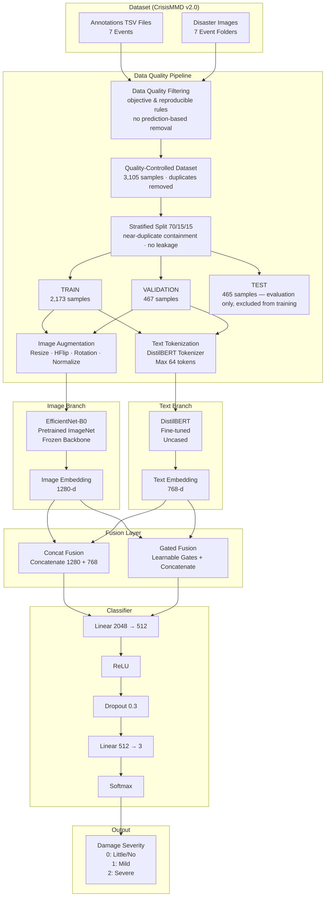
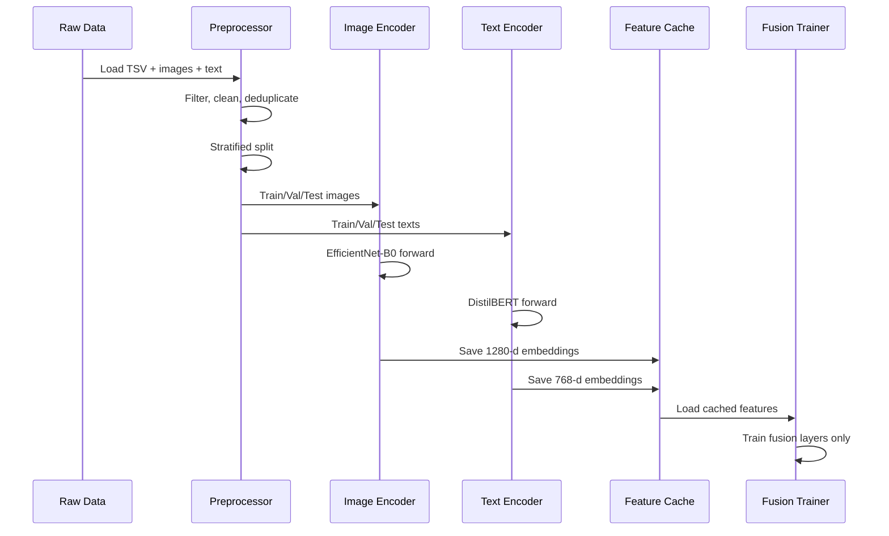
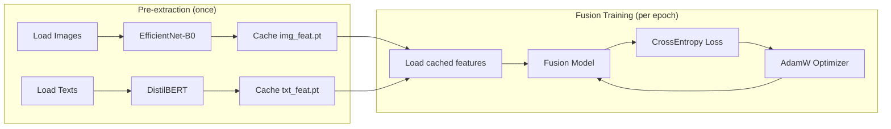
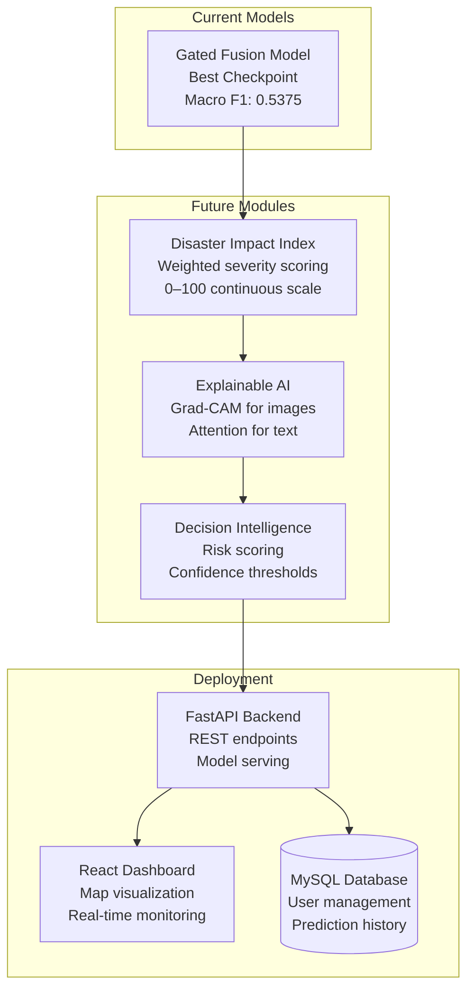

# 06 — Project Architecture

## 1. Current Pipeline



## 2. Module Architecture

### 2.1 Data Layer

```
backend/datasets/
├── multimodal_data.py     # Load TSVs, filter, clean, deduplicate
├── multimodal_dataset.py  # PyTorch Dataset (image → tensor, text → token IDs)
├── text_preprocessing.py  # URL removal, whitespace normalization
├── text_dataset.py        # PyTorch Dataset for text-only
├── prepare_data.py        # Image dataset loading
├── data_loader.py         # Image data loaders
└── analyze_severity_text.py  # Text analysis utility
```

### 2.2 Model Layer

```
backend/models/
├── fusion_models.py       # ImageFeatureExtractor, TextFeatureExtractor,
                          # ConcatFusion, GatedFusion
├── efficientnet.py        # EfficientNet-B0 builder
└── text_model.py          # DistilBERT builder
```

### 2.3 Training Layer

```
backend/training/
├── fusion_trainer.py      # Fusion training loop
├── fusion_evaluate.py     # Fusion evaluation + metrics
├── fusion_comparison.py   # Model comparison table generator
├── train.py               # Image training loop
├── evaluate.py            # Image evaluation
├── text_trainer.py        # Text training loop
├── text_evaluate.py       # Text evaluation
├── visualize.py           # Plotting (curves, CM, distributions)
└── config.py              # All hyperparameters and paths
```

## 3. Feature Extraction Pipeline



## 4. Training Pipeline



## 5. Future Pipeline



## 6. Code Entry Points

| Script | Purpose |
|---|---|
| `run_image_baseline.py` | Train/evaluate image-only EfficientNet-B0 |
| `run_text_baseline.py` | Train/evaluate text-only DistilBERT |
| `run_fusion.py` | Extract features, train/evaluate both fusion models |
| `dataset_audit.py` | Dataset exploration and statistical analysis |
